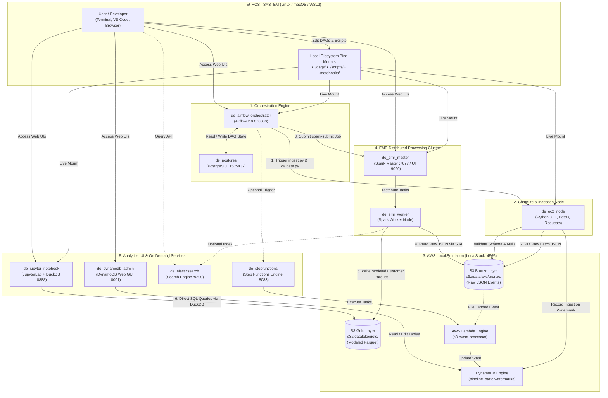

# 🚀 Local AWS Data Engineering Platform

A production-grade, zero-cloud-cost local AWS Big Data & Data Engineering ecosystem built with **Docker Compose**, designed for local development, data modeling, batch ingestion, validation, and pipeline orchestration.

This repository replicates an enterprise AWS Data Platform on your desktop for **$0**, featuring **S3, EMR (Apache Spark), Apache Airflow, EC2 compute nodes, JupyterLab, DuckDB, DynamoDB, AWS Lambda, Step Functions, and Elasticsearch**.

---

## 🏗️ Architecture Diagram



---

## 📊 End-to-End Pipeline Data Lifecycle

1. **Ingestion (`scripts/ingest.py` on EC2 Node):** Simulates API/stream data generation and writes timestamped JSON event batches into `s3://datalake/bronze/transactions/`.
2. **Data Validation (`scripts/validate.py` on EC2 Node):** Circuit-breaker quality gate ensuring mandatory schema fields and null-check constraints pass before proceeding.
3. **State & Watermark Tracking:** Updates `pipeline_state` in DynamoDB with high-water marks for incremental CDC ingestion.
4. **Distributed ETL & Modeling (`scripts/etl_modeling.py` on EMR/Spark):** Reads Bronze JSON via S3A, filters corrupted records, computes a Customer Summary dimension (`total_spent`, `total_orders`), and writes compressed Apache Parquet to `s3://datalake/gold/dim_customer_summary/`.
5. **Interactive Exploration (JupyterLab + DuckDB):** Execute sub-second vectorized SQL queries directly on the Gold Parquet dataset without JVM overhead.

---

## 🌐 Web Dashboards & Port Reference

| Service | Local Dashboard | Default Credentials | Description |
| :--- | :--- | :--- | :--- |
| **Apache Airflow** | [http://localhost:8080](http://localhost:8080) | `admin` / `admin` | DAG orchestration, monitoring & logs |
| **EMR / Spark Master** | [http://localhost:9090](http://localhost:9090) | *None* | Spark cluster status, workers, application runs |
| **JupyterLab** | [http://localhost:8888](http://localhost:8888) | *None* | Interactive notebooks & DuckDB analysis |
| **DynamoDB Admin** | [http://localhost:8001](http://localhost:8001) | *None* | Visual table manager & watermark inspection |
| **Elasticsearch** | [http://localhost:9200](http://localhost:9200) | *None* | Full-text search engine API |
| **LocalStack Gateway** | `http://localhost:4566` | AWS key: `test` / `test` | AWS S3, Lambda, DynamoDB endpoint |
| **Step Functions** | `http://localhost:8083` | AWS key: `test` / `test` | AWS Step Functions Local API |

---

## 📁 Repository Structure

```text
local-de-platform/
├── docker-compose.yml       # Complete service definitions & networks
├── Dockerfile.airflow       # Airflow image with Docker CLI capabilities
├── dags/
│   └── de_pipeline_dag.py   # Airflow end-to-end DAG orchestrator
├── scripts/
│   ├── ingest.py            # Raw batch ingestion to S3 Bronze
│   ├── validate.py          # Data quality & schema validation checks
│   ├── etl_modeling.py      # Distributed PySpark ETL to S3 Gold Parquet
│   ├── lambda_handler.py    # Local Lambda event handler
│   └── statemachine.json    # AWS Step Functions state machine
└── notebooks/
    └── explore_data.ipynb   # Jupyter exploratory analysis using DuckDB
```

---

## 🚀 Getting Started

### Prerequisites
* **Docker** & **Docker Compose** (v2+)
* **Python 3.10+** (Optional, for host scripting)
* **AWS CLI v2** (Optional, for running AWS CLI commands locally)
* Memory: Minimum **16 GB RAM** recommended.

### 1. Clone the Repository
```bash
git clone https://github.com/<your-username>/local-aws-data-engineering-platform.git
cd local-aws-data-engineering-platform
```

### 2. Configure AWS CLI (Local Profile)
Configure a dummy profile so your AWS CLI routes to LocalStack:
```bash
aws configure --profile local
```
* **AWS Access Key ID:** `test`
* **AWS Secret Access Key:** `test`
* **Default region name:** `us-east-1`
* **Default output format:** `json`

*(Optional)* Install `awslocal` for zero-configuration CLI commands:
```bash
pip install awscli-local
```

### 3. Launch the Core Platform
Start the core data engineering stack (S3, EC2 Node, Spark Master & Worker, Airflow, Postgres, and Jupyter):
```bash
docker compose up --build -d
```

Verify that all containers are healthy:
```bash
docker compose ps
```

---

## 🧪 Running the Pipeline

### Option A: Fully Automated via Airflow (Recommended)
1. Open [http://localhost:8080](http://localhost:8080) (`admin` / `admin`).
2. Toggle the DAG **`end_to_end_de_pipeline`** to **Active**.
3. Click the **Trigger DAG** (Play) button.
4. Watch the pipeline complete:
   $$\text{1\_ingest\_data\_to\_s3} \longrightarrow \text{2\_validate\_bronze\_data} \longrightarrow \text{3\_run\_emr\_spark\_etl}$$

### Option B: Step-by-Step CLI Execution

#### Step 1: Ingest Data into S3 Bronze
```bash
docker exec -it de_ec2_node python /app/scripts/ingest.py
```
Verify the Bronze JSON file in S3:
```bash
aws --endpoint-url=http://localhost:4566 --profile local s3 ls s3://datalake/bronze/transactions/
```

#### Step 2: Validate Data Quality
```bash
docker exec -it de_ec2_node python /app/scripts/validate.py
```

#### Step 3: Run EMR Spark ETL & Data Modeling
```bash
docker exec -it de_emr_master /opt/spark/bin/spark-submit \
  --master spark://spark-master:7077 \
  --conf spark.jars.ivy=/tmp/.ivy2 \
  --packages org.apache.hadoop:hadoop-aws:3.3.4,com.amazonaws:aws-java-sdk-bundle:1.12.262 \
  /opt/spark/scripts/etl_modeling.py
```
Verify the Gold Parquet model in S3:
```bash
aws --endpoint-url=http://localhost:4566 --profile local s3 ls s3://datalake/gold/dim_customer_summary/
```

#### Step 4: Query Gold Parquet with DuckDB (in JupyterLab)
Open **[http://localhost:8888](http://localhost:8888)** and run:
```python
import duckdb

con = duckdb.connect()
con.execute("""
    INSTALL httpfs; LOAD httpfs;
    SET s3_endpoint='localstack:4566';
    SET s3_use_ssl=false;
    SET s3_url_style='path';
    SET s3_access_key_id='test';
    SET s3_secret_access_key='test';
""")

df = con.execute("SELECT * FROM 's3://datalake/gold/dim_customer_summary/*.parquet'").df()
display(df)
```

---

## ⚡ On-Demand Services (Docker Profiles)

To preserve system RAM, optional services are grouped under the `--profile extra` tag:
* **DynamoDB Admin Web GUI** (Port 8001)
* **AWS Step Functions Local** (Port 8083)
* **Elasticsearch 7.17** (Port 9200)

### Spin up optional services:
```bash
docker compose --profile extra up -d
```

### Spin up an individual service:
```bash
docker compose up -d dynamodb-admin
```

### Stop optional services to reclaim memory:
```bash
docker compose stop elasticsearch dynamodb-admin stepfunctions-local
```

---

## 🛠️ Management & Troubleshooting

### Daily Operations
* **Pause the platform:** `docker compose stop`
* **Resume the platform:** `docker compose start`
* **Restart platform after system sleep:** `docker compose restart`
* **Tear down completely (preserves volumes):** `docker compose down`
* **Wipe everything and reset:** `docker compose down -v`

### Common Issues & Fixes
* **Docker Socket Permission in Airflow:**
  ```bash
  sudo chmod 666 /var/run/docker.sock
  ```
* **Ivy Cache Permission in Spark:**
  ```bash
  docker exec -u 0 de_emr_master mkdir -p /home/spark/.ivy2 /tmp/.ivy2
  docker exec -u 0 de_emr_master chmod -R 777 /home/spark /tmp/.ivy2
  ```
* **LocalStack Auth Token Error:**
  Ensure you are using `localstack/localstack:3.8.1` which does not require an external auth token.

---

## 📜 License
This project is open-source and available under the [MIT License](LICENSE).
